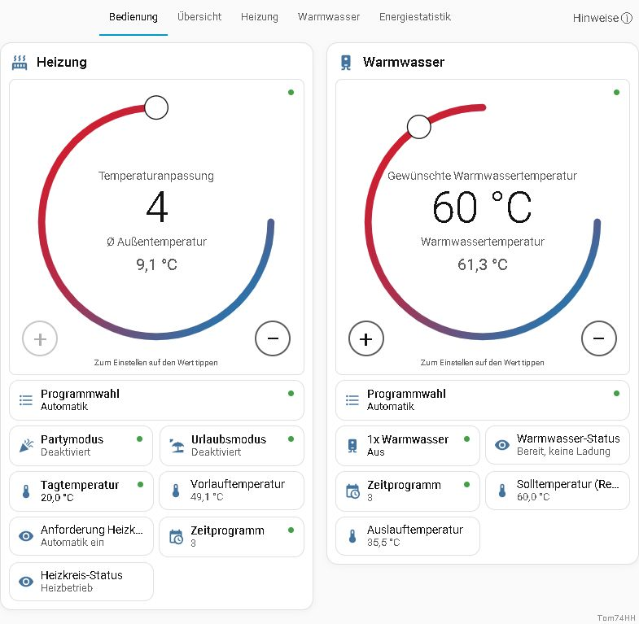
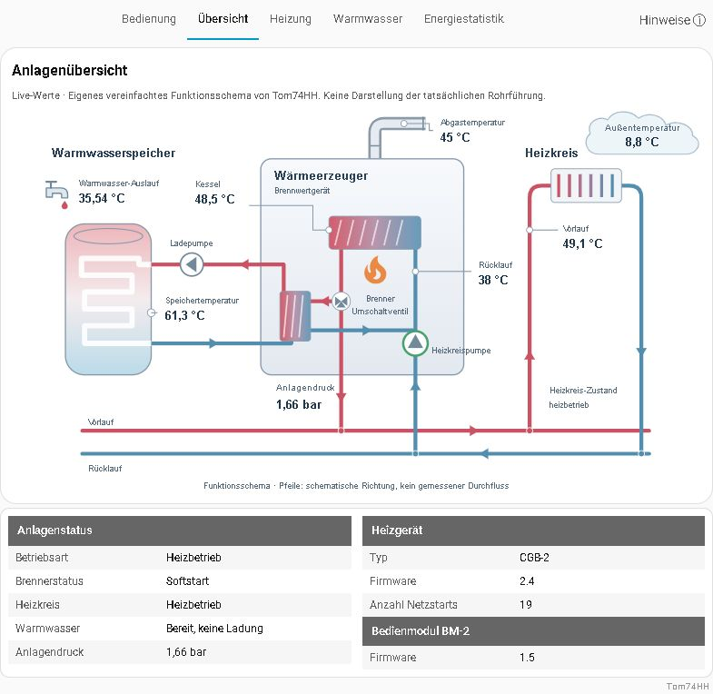

# WolfLink local

Lokale Home-Assistant-Integration für WOLF-Heizungen mit ISM7. Unabhängiges Community-Projekt von **Tom74HH**, keine offizielle WOLF-Anwendung.

**Entwicklungsstand 0.3.0b1:** Im eigenen System erprobt; weitere Tests mit anderen Anlagen sind willkommen. Prüfe zuerst die Messwerte im Read-only-Modus.

Datenschutz und sichere Fehlermeldungen: [PRIVACY.md](PRIVACY.md).

Ausführliche Anleitung: [INSTALLATION.md](INSTALLATION.md). Funktionen und Grenzen: [BESCHREIBUNG.md](BESCHREIBUNG.md).

## Einblicke in die Oberfläche

Die Screenshots zeigen die Bedienung und die Anlagenübersicht einer Beispielansicht. Die verfügbaren Messwerte und Funktionen hängen von der angeschlossenen Anlage ab. Browseradresse und persönliche Home-Assistant-Navigation sind nicht abgebildet.

### Bedienung

Temperaturen, Programmwahl, Zeitprogramme und Betriebszustände für Heizung und Warmwasser.

### Anlagenübersicht

Eigenes Funktionsschema mit Messwerten, Anlagenstatus und Geräteinformationen.

## Installation auf einem anderen System

1. Den vollständigen Ordner `wolflink_local` nach `/config/custom_components/` kopieren. Ergebnis: `/config/custom_components/wolflink_local/manifest.json`. Nicht doppelt verschachteln.
2. Home Assistant neu starten.
3. Einstellungen → Geräte & Dienste → Integration hinzufügen → **WolfLink local**.
4. Modul-IP und eigenes Modulpasswort eingeben.
5. Die automatisch erzeugte Seite **WolfLink local** in der Seitenleiste öffnen. Nach Updates den Browser vollständig neu laden.

Eigene Zugangsdaten und Einstellungen speichert HA außerhalb dieses Ordners in seiner Konfiguration. Diese Dateien nicht weitergeben. Das Paket enthält keine persönliche HA-Konfiguration. Ein vorhandenes persönliches Dashboard wird weder mitgeliefert noch verändert.

## Oberfläche und Bedienung

Enthalten sind Bedienung, Anlagenübersicht, tabellarische Heizung/Warmwasser, Zeitprogramme mit Tageseditor und Kopierfunktion sowie Party-/Urlaubsdialoge. Energiestatistik und Geräteinformationen erscheinen nur bei passenden Gerätewerten. Entitäten werden je Gerät über die Registry zugeordnet; feste private Entitäts- oder Gerätekennungen sind nicht erforderlich.

Die Übersicht verwendet ein eigenständig gezeichnetes, vereinfachtes Funktionsschema. Bei anderen Anlagen kann das tatsächliche hydraulische Schema abweichen. Nicht verfügbare Messwerte erhalten keine erfundenen Ersatzwerte. Die optionale Raumtemperatur bleibt für Anlagen mit entsprechendem Fühler unterstützt.

Statuspunkte: Blau = Senden, Gelb = übertragen und Bestätigung ausstehend, Grün = gelesen/bestätigt, Rot = Fehler oder nicht bestätigt, Grau = nicht verfügbar. Grün bedeutet nicht zwingend eingeschaltet. Bestätigt wird anhand des zurückgelesenen Anlagenwertes. Ausführliche Bedienhinweise und Prüfzeiten stehen im Infofeld der Oberfläche.

Neue Einträge beginnen im Read-only-Modus. Schreibzugriffe können in den Integrationsoptionen freigegeben werden. Beim Start werden keine Steuerbefehle ausgeführt.

## Lokale Verbindung

Unterstützt wird die CGB-2-Familie einschließlich CGW-2 mit einem BM-2. Bei mehreren BM-2 oder Wärmeerzeugern wird keine Zuordnung geraten. Geräteidentität und Zertifikat werden nach der ersten erfolgreichen Verbindung gespeichert und bei Folgeverbindungen geprüft.

Mess-/Statuswerte und Grundsteuerungen umfassen unter anderem Programmwahl, aktives Zeitprogramm, Warmwasser-Solltemperatur, Temperaturanpassung, Tagtemperatur und 1x Warmwasser. Tageszeitfenster und Party-/Urlaubszeiträume werden nach erfolgreicher Leseprüfung gerätebezogen freigeschaltet.

Lokale Zeitprogramme: drei Profile, sieben Tage, maximal drei editierbare Zeitfenster; weitere Speicherplätze werden beim Lesen berücksichtigt. Vor dem Schreiben erfolgt ein Vergleich mit dem aktuellen Tag. Schreibbefehle werden nur einmal gesendet. Ende 24:00 wird derzeit abgewiesen, weil der bekannte Encoder auf 23:59 verkürzt; es erfolgt keine stille Rundung.

Party/Urlaub: Zeitraum schreiben und zurücklesen, danach aktivieren. Bei unsicherem Zeitraum wird nicht aktiviert. Die BM-2-Uhr darf höchstens fünf Minuten von HA abweichen. Ungültige oder bei Zeitumstellung mehrdeutige Zeitpunkte werden abgewiesen.

## Abfragetakt und Rückmeldung

Standard 60 Sekunden, einstellbar von 15 bis 900 Sekunden. Nach Schreibzugriffen wird häufiger zurückgelesen. Einzelheiten stehen in BESCHREIBUNG.md und im Infofeld.

## Energiestatistik und Geräteinformationen

Verfügbare Energiezähler werden nach Bereich und Zeitraum angezeigt, einschließlich Gesamtmenge und prozentualem Heizungs-/Warmwasseranteil. Fehlende Werte werden nicht durch Null ersetzt; bei Gesamtsumme Null werden keine Prozentanteile berechnet. Geräteinformationen zeigen verfügbare Firmware- und Netzstartwerte. Leere Wartungs- oder Herstellungsbereiche werden nicht angelegt.

Die Anzahl der Entitäten hängt vom Gerät, den lesbaren Parametern und optionalen Sensoren ab. Mehrere Anzeigen können denselben nativen Datenpunkt verwenden, der pro Abruf nur einmal gelesen wird.

## Prüfstand und Grenzen

An der Entwicklungsanlage wurden lokale Anmeldung, Erkennung, Messwerte, Energiezähler und Geräteinformationen gelesen; grundlegende Schreibzugriffe wurden vom Nutzer bestätigt. Ein Tageszeitfenster im ungenutzten Heizprofil 1 wurde geändert, unabhängig zurückgelesen, bytegenau wiederhergestellt und erneut geprüft. Das aktive Profil 3 blieb unverändert.

Party-/Urlaubsfelder wurden live gelesen; deren Aktivierung wurde mit gemocktem Gerät geprüft und nicht an der laufenden Heizung ausgelöst. Automatisierte Tests ersetzen keinen Hardwaretest auf jedem Anlagentyp. Eine vollständig frische Installation auf einem anderen HA-System muss noch praktisch erprobt werden. Anlagenzähler sind keine separat geprüfte Verbrauchsmessung.

## Update und Entfernen

Bei einem Update den Integrationsordner ersetzen und HA neu starten; eigene HA-Zugangsdaten bleiben in der HA-Konfiguration. Bei älteren manuellen Installationen können alte `/local/`-WolfLink-Ressourcen entfernt werden; andere Ressourcen unverändert lassen. Alte www-Dateien werden nicht benötigt.

Beim Entladen der letzten Instanz wird die automatisch erzeugte Seite entfernt. Persönliche Dashboards bleiben erhalten. Die automatisch erzeugte Seite ist nicht im Dashboardeditor bearbeitbar.

## Weitergabe und Lizenzen

Das gemeinsame native Protokollzertifikat und der zugehörige Schlüssel unter `local/` sind erforderliche gemeinsame Protokollressourcen, keine persönlichen Zugangsdaten. Modulpasswörter und Gerätebindungen werden erst in der jeweiligen HA-Installation gespeichert.

Das kombinierte Paket steht unter GPL-3.0; bestehende Apache-2.0-Hinweise bleiben erhalten. Siehe LICENSE, NOTICE und local/LICENSE.GPL-3.0. Logo und Übersichtsgrafik sind eigene Projektgrafiken; originale WOLF-Bilddateien werden nicht mitgeliefert. Dies ist keine offizielle WOLF-Anwendung.

Die zusätzlichen Tages- und Jahreswerte sind rechnerische WOLF-Anlagenwerte und noch nicht am BM-2 gegengeprüft; Details und Quelle stehen in BESCHREIBUNG.md.

Ausschließlich lokale ISM7-Anbindung. Keine zusätzliche Python-Abhängigkeit und kein WOLF-Konto erforderlich. Geprüft mit Home Assistant 2026.10.1 und CGW-2/CGB-2 mit BM-2. Modul-IP und eigenes Passwort bei der Einrichtung angeben. Ordner und Integrationsdomain heißen `wolflink_local`.
## Entwicklung unterstützen

WolfLink local bleibt kostenlos und Open Source. Wenn dir das Projekt gefällt und du die Weiterentwicklung unterstützen möchtest, freue ich mich über einen kleinen Kaffee. Die Unterstützung ist freiwillig und mit keinen zusätzlichen Funktionen oder Supportzusagen verbunden.

[☕ Tom74HH über GitHub Sponsors unterstützen](https://github.com/sponsors/Tom74HH)
